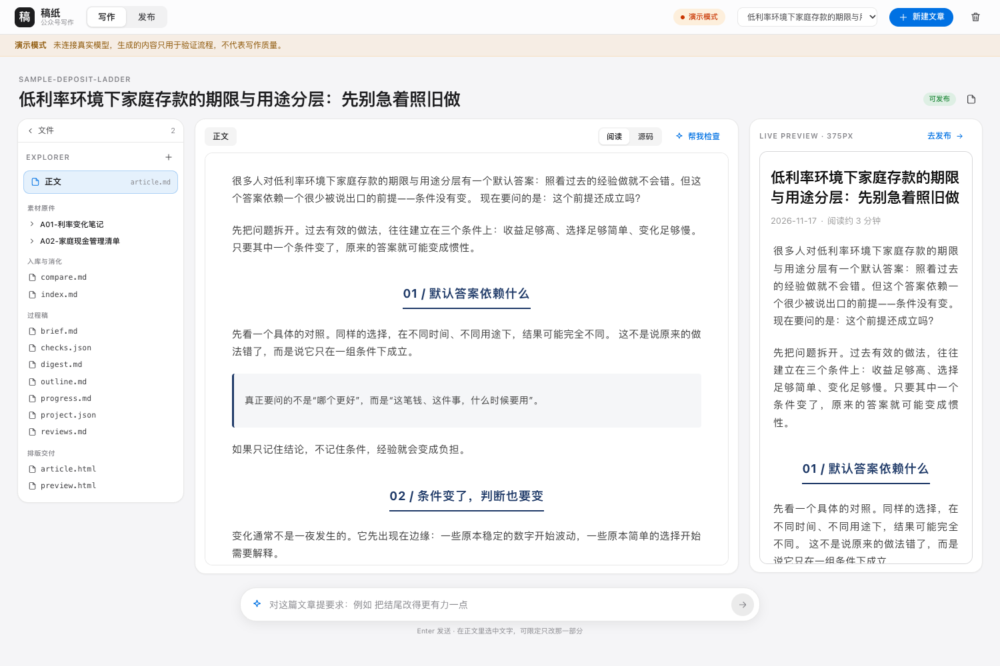
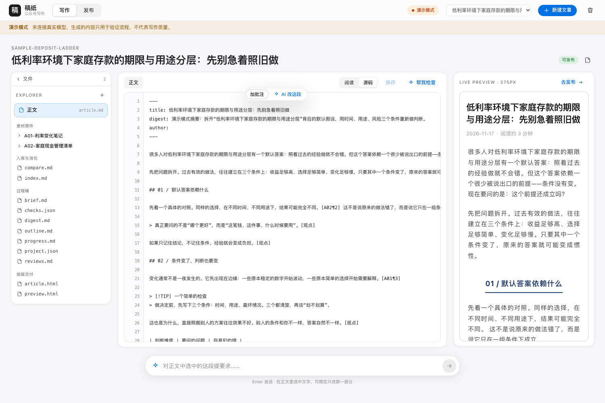
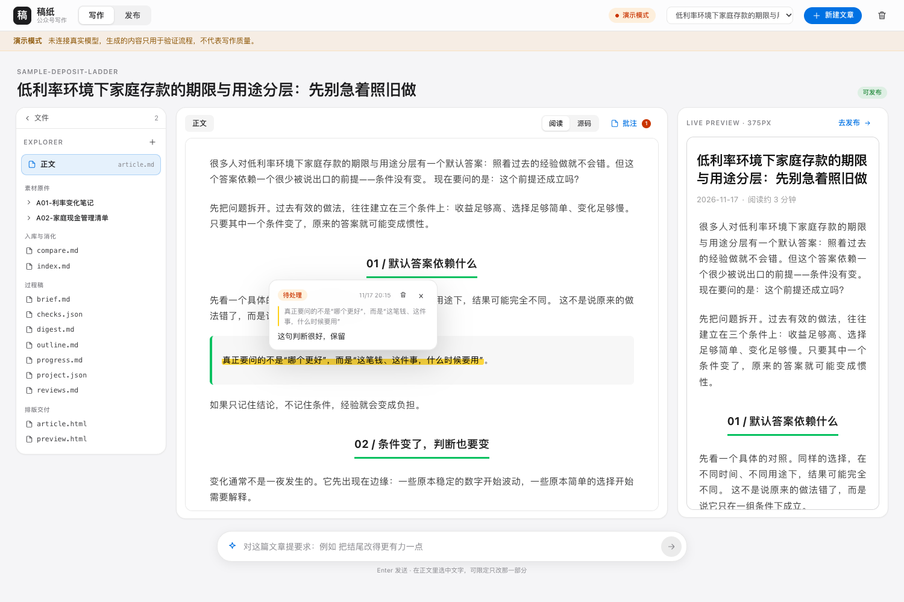
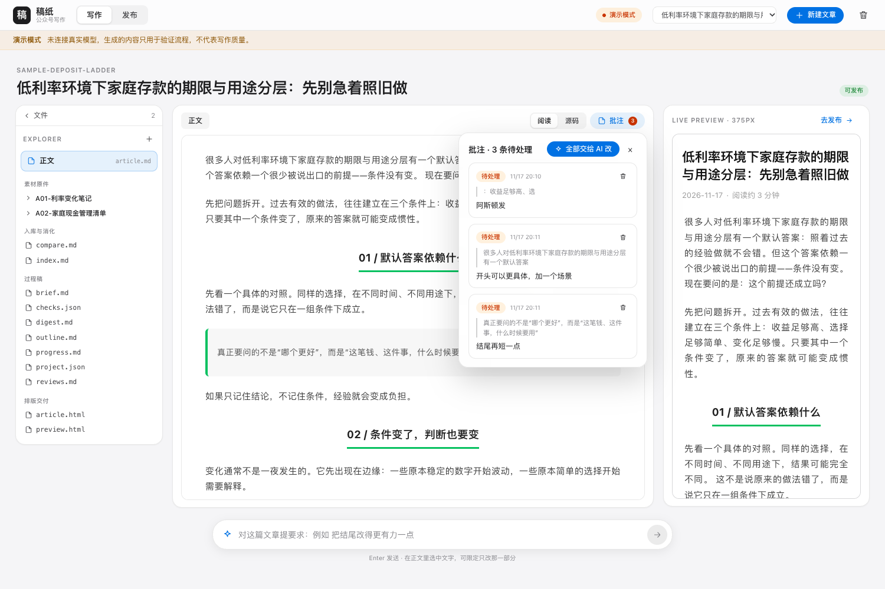
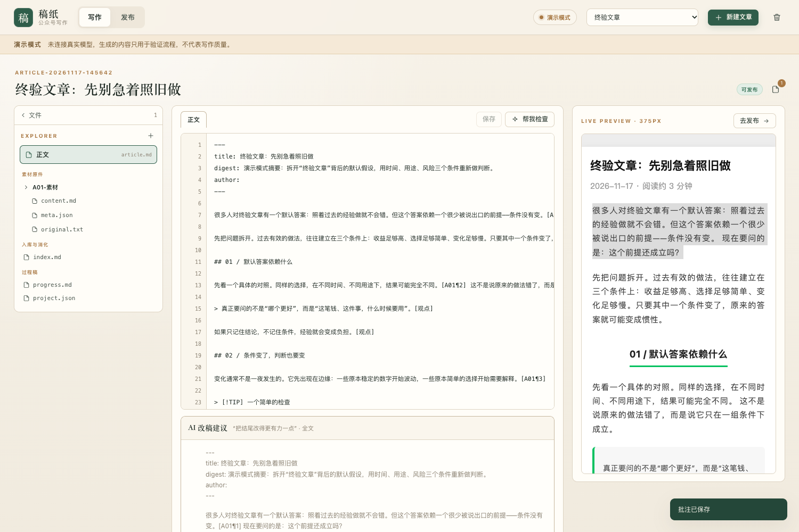
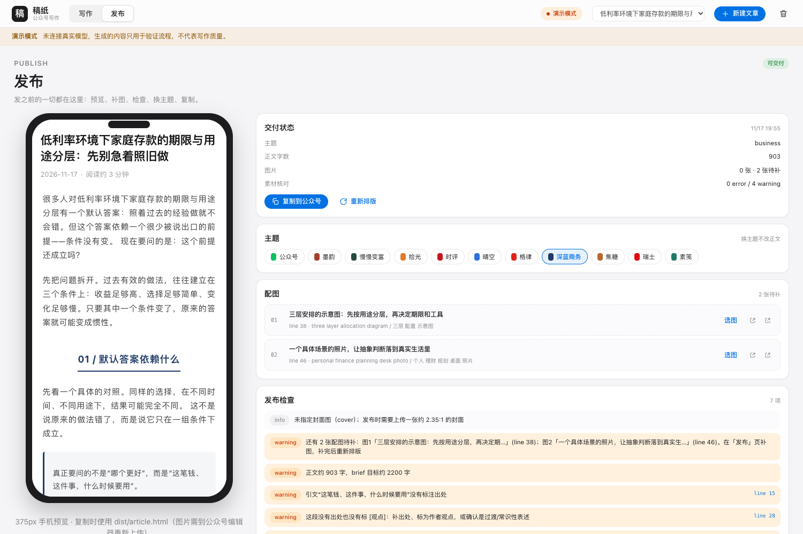

# 稿纸 · 公众号写作

一个以**文章本身**为中心的公众号写作工具：素材丢进来，AI 在后台消化、拟大纲、写初稿；你在编辑器里过目、划一段让 AI 改、最后排版复制。只在初稿完成时停一次。

**一篇文章 = 一个项目。** 项目里保存素材、正文、配图和排版产物；状态在 SQLite 里，刷新页面、重启服务都接着走。



## 它怎么用

```text
新建文章（标题 + 可选素材）→ AI 直接开写（后台：消化 · 大纲 · 初稿）
      → 初稿完成，停一次 → 你直接改 / chatbox 让 AI 改（diff 确认）
      → 定稿 → 选标题（5 选 1）→ 发布页：补图 · 检查 · 换主题 · 复制到公众号
```

新建时只问一个问题（标题/选题），素材可以直接拖进创建框；有素材就自动开写，LLM 根据素材自己写出大概，之后你在编辑器里接管。

- **只停一次**：没有四道审批。AI 的工序（简报、消化、大纲）在后台完成，产物落盘但不打扰你。
- **正文默认是渲染稿**：中间直接看排版后的文章（阅读 / 源码一键切换），右侧 375px 手机预览只读、随正文滚动同步。
- **chatbox 改稿**：底部是对文章说话的输入框（Enter 发送）；在正文里选中一段再发，就只改那一部分；AI 的修改以 diff 卡片呈现，接受才生效。
- **批注在正文上做**：正文里选中文字 → 加批注；已批注的原文像荧光笔一样高亮，点击即可浮出批注内容；批注可一键全部交给 AI 改。
- **标题 5 选 1**：定稿后标题候选出现在编辑器上方，点一个就写回 frontmatter 并排版。
- **排版可交付**：Markdown → 语义 HTML → 主题 CSS 算成行内样式；输出 `dist/article.html`，直接粘进公众号编辑器。
- **离线可跑**：没有 `OPENAI_API_KEY` 时自动进入演示模式，界面明确标注。

## 界面

| 写作（渲染正文 + 只读手机预览） | 源码模式 |
|---|---|
|  |  |

| 选中文字：批注 / AI 改这段 | 批注面板：全部交给 AI 改 |
|---|---|
|  |  |

| AI 改稿 diff | 发布 |
|---|---|
|  |  |

顶部只有 **写作 · 发布** 两个视图。

- **写作**：VS Code 式三栏——左边是文件资源管理器（「正文」置顶特殊标记，其余是素材与过程文件），中间是**渲染后的正文**（批注、划选改稿都在这里，可切「源码」编辑 Markdown），右边是只读的 375px 手机预览，底部是 chatbox。
- **发布**：手机预览、发布检查清单、待补图位、主题切换、复制到公众号。

## 快速开始

### 一条命令

```bash
./run.sh
```

自动完成：找 Python 3.11+ → 建 `.venv` → 装后端依赖 → 复制 `.env` → 构建前端（需 Node ≥ 20）→ 启动 <http://127.0.0.1:8765>。

### 手动

```bash
python3.11 -m venv .venv && source .venv/bin/activate
pip install -e '.[dev]'
cp .env.example .env
(cd web && npm install && npm run build)
uvicorn app.main:app --host 127.0.0.1 --port 8765
```

首次启动会创建示例文章 `sample-deposit-ladder`（演示内容）。不想要就设 `GZH_SEED=0`。

## 配置

编辑 `.env`：

| 变量 | 默认 | 说明 |
|---|---|---|
| `GZH_PROVIDER` | 自动 | `anthropic` 或 `openai`；有 `ANTHROPIC_AUTH_TOKEN` 时默认 anthropic |
| `ANTHROPIC_BASE_URL` | `https://api.anthropic.com` | Anthropic 兼容网关地址（Claude Code 同款即可） |
| `ANTHROPIC_AUTH_TOKEN` | 空 | Anthropic 网关 Token（`Authorization: Bearer`） |
| `GZH_MAX_TOKENS` | `1000000` | 单次输出上限；网关拒绝时自动降级重试到更小的值 |
| `GZH_MODEL` | 按提供商 | anthropic 默认 `deepseek-v4.1-flash-1017`，openai 默认 `gpt-4o-mini` |
| `OPENAI_API_KEY` | 空 | OpenAI-compatible 接口的 Key |
| `OPENAI_BASE_URL` | `https://api.openai.com/v1` | 可换 DeepSeek / 通义 / 本地 vLLM |
| `GZH_DATA_DIR` | `./workspace` | 项目、SQLite、主题的根目录 |
| `GZH_AUTHOR` | 空 | 默认作者名 |
| `GZH_THEME` | `wechat` | 新文章默认主题 |
| `GZH_TARGET_CHARS` | `2800` | 默认目标字数 |
| `GZH_CITATION_MODE` | `strip` | `strip` / `references` / `footnotes` |
| `GZH_SEED` | `1` | 首次启动生成示例 |
| `GZH_BILIBILI_BROWSER` | 空 | B 站字幕：从哪个浏览器读登录态（chrome / safari / edge / firefox…） |
| `GZH_BILIBILI_COOKIE_FILE` | 空 | B 站字幕：Netscape 格式 cookies.txt 路径（与上一项二选一） |

API Key 只在服务端使用，不会返回给前端。

## B 站视频字幕

素材面板的「B站」标签：粘贴视频链接 → 取播放器已有字幕（含 AI 字幕）→ 转成口语稿素材（`Sxx`，带 `[¶n @mm:ss]` 锚点）。

实现方式与 [Diorvh/codex-bilibili-subtitles](https://github.com/Diorvh/codex-bilibili-subtitles) 一致：yt-dlp 只下载字幕轨道，不下载音视频；登录态通过 `--cookies-from-browser` 在进程内读取，不导出 Cookie。

B 站的字幕轨道（尤其 AI 字幕）**需要登录才能读取**：

```bash
# 方式一：在 Chrome/Safari 登录 B 站，然后（读 Chrome Cookie 前建议先退出 Chrome）
GZH_BILIBILI_BROWSER=chrome

# 方式二：自己导出 Netscape cookies.txt，指向它
GZH_BILIBILI_COOKIE_FILE=/path/to/cookies.txt
```

没配置或没登录时会明确报错，并提示下一步。只支持单个视频链接（不支持播放列表/批量）。

## 工作流（后台）

```text
START → prepare → research（简报+消化+大纲，内部产物）→ draft → ◆interrupt：初稿完成
      → titles（生成 5 个标题候选）→ END
```

- 整个图只有**一次 interrupt**：初稿完成。确认后进 `titles`，之后图结束。
- 标题选定不走图：用户点候选 → `POST /title` 写回 frontmatter、渲染、标记完成。
- 评审保留了 `POST /review` API（后端能力），当前界面不再展示「帮我检查」入口；日常改稿走 chatbox 与批注。
- AI 改稿（划选/全文）也是独立 API（`POST /edit`），返回改动前后文本，前端 diff 确认后落盘。
- `thread_id = slug`，SQLite checkpointer 持久化；服务重启后中断/已完成状态都能恢复。

## 项目目录

```text
workspace/
  wechat-projects/<slug>/
    project.json          素材索引 + workflow 状态
    article.md            正文（frontmatter + 溯源标记）
    brief.md outline.md digest.md reviews.md progress.md   # 内部产物
    checks.json           最近一次 lint + source check
    title-options.json    标题候选
    sources/<A01…>/{original.*, content.md, digest.md, meta.json}
    images/fig-01.png
    dist/article.html preview.html
    .materials-comments.json
  styles/                 全局风格 + 主题库 + 每项目副本
  gzh.sqlite              LangGraph checkpoints
```

## 保留的核心能力

- **渲染引擎**：Markdown → 语义 HTML → 受限 CSS 引擎算成行内 `style`、删除 `class`。`dist/article.html` 无 `<style>` / `class=` / `<script>`。
- **11 套主题**：wechat / business / swiss / manfu / gelv / jiaotang / moyun / qingkong / shiping / shiguang / sujian。换主题只换 CSS，正文一个字不改。
- **素材锚点与原创检查**：正文 `[A01¶3]` / `[观点]` 只存在 article.md；渲染时剥掉。lint 检查极限词、`source-mention`、`verbatim-copy`；source_check 核对引语与数字。
- **配图占位符**：AI 只放 `ww-img:pending`（绝不生成 ``），你在发布页补图，填完自动重排。
- **demo 模式**：无 Key 时整条流程可跑通。

渲染正确性由原插件 JS 渲染器生成的 golden 文件逐主题对比（11/11 一致），见 `tests/golden/`。

## API 摘要

统一错误：`{"detail": {"message": "...", "code": "..."}}`。

| 方法 | 路径 | 作用 |
|---|---|---|
| GET | `/api/health` | 版本 / demo / 模型 |
| GET/POST | `/api/projects` | 文章列表 / 新建 |
| GET/DELETE | `/api/projects/{slug}` | 详情 / 删除（含 checkpoint） |
| POST | `/api/projects/{slug}/materials/upload|text|url` | 素材入库 |
| GET | `/api/projects/{slug}/sources` · `/sources/{id}/read` | 素材列表 / 按锚点读 |
| POST | `/api/projects/{slug}/start` | 开始写作（唯一中断流水线） |
| POST | `/api/projects/{slug}/resume` | `{action: approve|revise, feedback?}` |
| GET | `/api/projects/{slug}/state` · `/events` | 状态轮询 / SSE |
| POST | `/api/projects/{slug}/preview` | 实时预览（不落盘，传 markdown 或读文件） |
| POST | `/api/projects/{slug}/edit` | AI 改稿，返回 before/after |
| POST | `/api/projects/{slug}/review` | 按需评审 |
| POST | `/api/projects/{slug}/title` | 选定标题/摘要，写回并排版 |
| GET | `/api/projects/{slug}/deliverable` | 成稿 HTML / stale / 检查 |
| POST | `/api/projects/{slug}/render` | 重新排版 |
| GET/POST | `/api/projects/{slug}/slots` · `slots/fill|clear` | 配图图位 |
| GET/POST/PATCH/DELETE | `/api/projects/{slug}/comments...` | 行批注 |
| GET | `/api/themes` | 主题库 |

## 测试

```bash
source .venv/bin/activate && pytest -q
(cd web && npm run typecheck && npm run build)
```

覆盖：素材解析（md/txt/html/srt/vtt/docx/URL）、锚点、11 主题 golden 渲染、lint/source check、单中断全流程（开始 → 初稿 → 定稿 → 选标题 → 交付）、revise 回路、重启恢复、按需评审、实时预览不落盘、diff 数据、图位、评论、路径安全。

## 已知边界

- 单用户本地工具；没有账号、协作、云端部署。
- 不做公众号草稿推送；图片需在公众号编辑器里重新上传。
- 不支持 PDF / 音频 / 视频直接解析。
- 演示模式只保证流程与结构，内容质量不代表真实模型。
- 评审 API（`POST /review`）保留但界面未接入；改稿以 chatbox / 批注 → diff 确认为主。

## 目录结构

```text
app/
  main.py config.py storage.py materials.py errors.py events.py
  lint.py sourcecheck.py images.py comments.py styles.py
  prompts.py llm.py demo.py render_service.py seed.py
  render/{markdown.py, css.py, themes.py, render.py, assets/}
  graph/{state.py, nodes.py, build.py, runner.py}
  api/routes.py
web/src/
  App.tsx hooks.ts api.ts ui.tsx diff.ts types.ts styles.css
  views/{WriteView.tsx, SourcesView.tsx, PublishView.tsx}
tests/  golden/theme-*.html
docs/   ARCHITECTURE.md PORTING-NOTES.md screenshots/
```

详细架构见 [`docs/ARCHITECTURE.md`](docs/ARCHITECTURE.md)，与 DSH 原插件的关系见 [`docs/PORTING-NOTES.md`](docs/PORTING-NOTES.md)。
